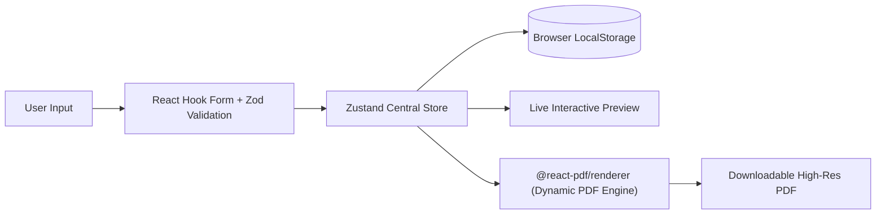

# 💍 ShaadiBio — Premium Marriage Biodata Builder

> A high-performance, modern web application for crafting elegant, publication-grade marriage biodatas with instant dynamic PDF generation and preview.

[](https://shaadi-bio.vercel.app)
[](https://nextjs.org/)
[](https://www.typescriptlang.org/)
[](https://tailwindcss.com/)
[](LICENSE)

---

## 🌟 Overview

**ShaadiBio** solves the hassle of manually creating marriage biodatas with messy Word documents or clunky graphic editors. It offers an intuitive, multi-step builder interface paired with a real-time reactive preview and seamless client-side PDF document rendering.

### ✨ Key Features

- **Multi-Step Dynamic Form Flow**:
  - Modular data entry sections: **Personal Details**, **Family Background**, **Education & Career**, **Lifestyle & Hobbies**, **Astrological Info (Kundali/Horoscope)**, and **Partner Preferences**.
  - Built with **React Hook Form** for low-re-render performance and **Zod** for robust runtime schema validation.
- **Client-Side State Persistence**:
  - Centralized state management using **Zustand** with local storage synchronization, ensuring users never lose their progress on page refresh or browser restart.
- **Dynamic PDF Compilation**:
  - High-fidelity, print-ready document rendering via `@react-pdf/renderer` with pixel-perfect typographic hierarchy, photo embedding, and customizable templates (*Minimal Modern*, *The Classic*, *Royal Heritage*, *Soft Floral*).
- **Responsive & Accessible UI**:
  - Built on top of **Radix UI** primitives for full keyboard accessibility and screen-reader compliance.
  - Smooth layout transitions and interactive states powered by **Framer Motion**.
- **SEO & Social Optimization**:
  - Dynamic OpenGraph cards, sitemaps, and robots.txt configured for search engine visibility.

---

## 🛠️ Architecture & Tech Stack



| Layer | Technology | Rationale |
| :--- | :--- | :--- |
| **Framework** | Next.js 14 (App Router) | Server components, file-system routing, and built-in image optimization |
| **Language** | TypeScript 5 | Strict typing across form models, template layouts, and PDF schemas |
| **State Management** | Zustand | Lightweight, unopinionated reactive store with persistent storage middleware |
| **Validation** | Zod + Hookform Resolvers | Type-safe declarative schema validation preventing malformed data entry |
| **PDF Generation** | `@react-pdf/renderer` | Deterministic, vector-sharp document layout compiled in the browser |
| **Component Primitives** | Radix UI | Unstyled, fully accessible interactive primitives |
| **Styling** | Tailwind CSS + `clsx` / `tailwind-merge` | Utility-first responsive design system with zero CSS conflicts |

---

## 🚀 Getting Started

### Prerequisites
- Node.js 18.0+ 
- npm / yarn / pnpm

### Installation

1. **Clone the repository**:
   ```bash
   git clone https://github.com/Aryan-0098/ShaadiBio.git
   cd ShaadiBio
   ```

2. **Install dependencies**:
   ```bash
   npm install
   ```

3. **Start the development server**:
   ```bash
   npm run dev
   ```

4. **Open in browser**:
   Navigate to [http://localhost:3000](http://localhost:3000) to view the application.

### Building for Production

```bash
npm run build
npm run start
```

---

## 📄 License

This project is licensed under the [MIT License](LICENSE).
